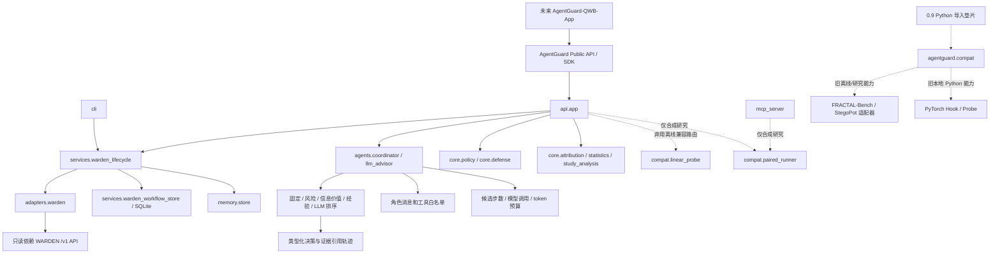

# AgentGuard 上层平台依赖图

日期：2026-10-24；分支 `feature/agentguard-upper-layer-v1`。



复现静态模块图：

```powershell
python scripts/audit_architecture.py --check --output .agentguard/architecture-a4.json
```

源码调用者按兼容边界划分：

| 兼容能力 | 生产/公开调用者 | 旧导入路径 |
| --- | --- | --- |
| `compat.linear_probe` | `api.app` 中 OpenAPI 标记 deprecated 的离线训练/预测端点 | `core.linear_probe` |
| `compat.paired_runner` | `api.app` 和 MCP 的合成研究工作流 | `core.paired_runner` |
| `compat.whitebox_activation` | 旧 Python 导出 | `whitebox.activation` 和 `whitebox` 包级导出 |
| `compat.fractal_bench` | 按需调用的旧 Python 场景适配 | `adapters.fractal_bench` 和包级惰性导出 |
| `compat.stegopot` | 按需调用的旧 Python 文件级实验适配 | `adapters.stegopot` 和包级惰性导出 |
| `core.attribution` | CLI、API 的上层描述性统计 | 同一上层模块 |

五份重复低层/直连实现位于 `agentguard.compat`。旧路径保留为兼容垫片；新
WARDEN 工作流与诊断不依赖这些实现，所有底层 API 调用经过
`WardenKernelClient`。`adapters` 包现在按需导入旧 FRACTAL-Bench/StegoPot
适配器，普通 WARDEN/Mock 导入不会初始化它们。

静态检查当前为 76 个模块、463 条导入；旧兼容路径和 `agentguard.compat` 单独列为兼容债务；白盒和
StegoPot/FRACTAL-Bench 的三个底层导入只允许出现在兼容实现中。AST 检查包括
函数内导入和字面动态导入，不判断代码运行时可达性，也不扫描 Python 隐式
包初始化以外的打包行为。
