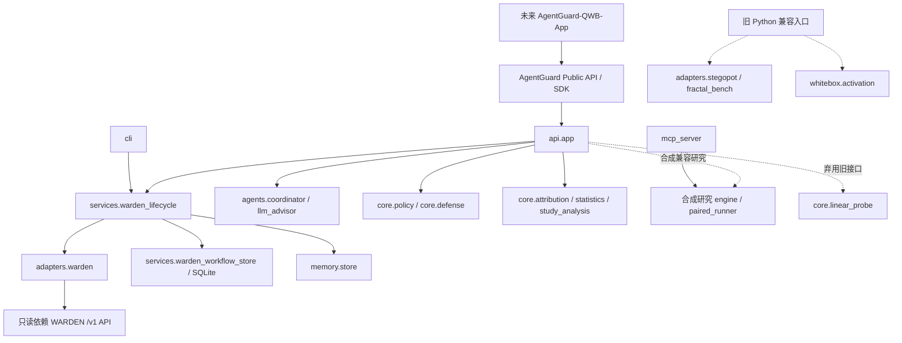

# AgentGuard 上层平台依赖图

日期：2026-10-24；分支 `feature/agentguard-upper-layer-v1`。



复现静态模块图：

```powershell
python scripts/audit_architecture.py --check --output .agentguard/architecture-a0.json
```

当前 67 个模块、431 条导入。报告列出每条内部导入的源码相对路径和行号、
六个重点模块的直接调用者、底层依赖及直接依赖环。它只解析 Python AST，
不会导入模型运行时或读取底层工件。条件导入也计入；计算生成的动态导入与
Python 隐式包初始化仍需要人工审查。

| 兼容模块 | 当前源码调用者 |
| --- | --- |
| `core.linear_probe` | `api.app:38`，弃用的训练/预测路由 |
| `core.attribution` | `api.app:58`、`cli:25`，上层离线统计 |
| `core.paired_runner` | `api.app:39`、`mcp_server:15`，合成配对研究 |
| `whitebox.activation` | `whitebox.__init__:2`，公开 Python 导出 |
| `adapters.fractal_bench` | `adapters.__init__:2`，公开 Python 导出 |
| `adapters.stegopot` | `adapters.__init__:3`，公开 Python 导出 |

三个直接底层导入位于 `adapters/fractal_bench.py:26`、
`adapters/stegopot.py:381`、`whitebox/activation.py:58`。允许清单仅登记兼容
债务，不授予新的生产用途。新生产模块不得直接导入这些底层包；真实运行
仍经 `WardenKernelClient`。API 已拒绝注入真实旧运行时与直接配对执行器。

A3 要处理的剩余边界是默认 API 内的旧 Probe 研究路由，以及旧模块的
明确弃用策略。它们不能因为静态越界清单为空就被认定已迁移完毕。
