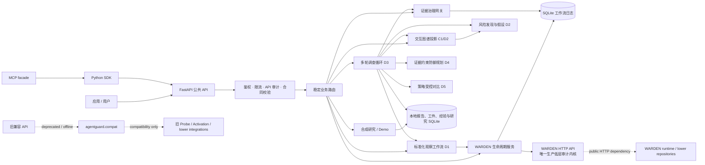

# AgentGuard 1.1.0-rc1 架构

## 边界说明

- WARDEN 是生产低层审计内核。AgentGuard 对其进行能力预检、请求验证、审批/预算
  门控、持久化生命周期协调和证据摘要；它不复制 WARDEN 的因果、Activation、Probe
  或 SAE 实现。
- 新业务路由通过公共 API 服务和 WARDEN 生命周期服务工作。`agentguard.compat` 仍被
  明确的旧/离线路由用于迁移兼容，但架构审计确认低层直接依赖仅位于该命名空间，
  没有生产边界越权或模块环。
- SQLite 保存本地 API 审计事件、工作流幂等/恢复状态、经验和研究登记；它不是远程
  WARDEN 的事务数据库，也不提供跨系统 exactly-once。
- Evidence Gateway 只投影有治理的摘要与可引用工件，不读取任意 URI 或本地路径。
- Demo/Mock 与真实 WARDEN 流程分离。合成或观察性结果不能升级为因果成功。
- **D 轮层（1.1.0-rc1）**：标准化观察工作流（D1）复用生命周期服务并校验内核
  声明的运行时标识；风险发现（D2）只消费图谱投影的结构元数据；多轮调查循环
  （D3）组合只读服务与 D1，受四重预算约束，LLM 仅推荐；防御规划（D4）与策略
  对比（D5）为纯上层投影/记录，不触碰内核。D 轮未新增 REST 路由，报告经
  内容寻址工件持久化。

## 静态边界审计

`scripts/audit_architecture.py --check` 通过：81 个 AgentGuard 模块、517 条导入，
0 个边界违规、0 个依赖环。仅 `agentguard.compat.fractal_bench`、
`agentguard.compat.stegopot` 与 `agentguard.compat.whitebox_activation` 导入低层或
PyTorch 依赖；这些不是生产 WARDEN 审计入口。
